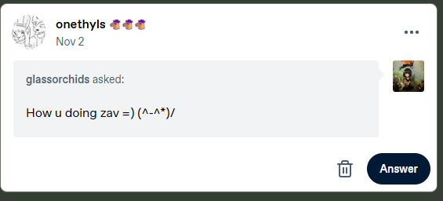

# Absence !!!!

Thank you, Fern. I'm sorry this took a minute.
If you've been waiting for an update on me, I have two answers:
- I don't believe you.
- Sorry this took so long. I promise I'll explain to the best of my ability...

---

If you've been keeping up via my Tumblr and SoundCloud (ew,) I've been posting here and there to remind people I'm not dead. However, I haven't had any serious time to sit down and write an actual blogpost about me since... maybe August? It's November now and a lot has happened since I finished the rewrite of this website.

**I'm in college now!!!** Community college, but nonetheless college. I plan to get my associate's degree and do something with it. Hopefully. I have like two missing assignments on Canvas because I've been at work and forgetting that I have school. Speaking of...

**I have a job!!** It pays my bills sort of!!! Speaking of bills...

**You can now buy beats!!!** This is a large deal for only me. Since I was 15, I was hesitant to post my beats until I felt absolutely ready and experienced in music production, but then I realized that I really don't care and would like extra money to sometimes do cool things. People also really like the Group 5 beats I post, so that warms my little heart. Any money I gain from this little endeavor will be used to supplement needs, like housing and electricity. And ordering doordash. That shit is a luxury that I don't even touch unless nothing is in the fridge or I feel fancy.

**I'm releasing more music!!!** It's been a weird schedule to try to squeeze music in, but I somehow do. It feels like more of a chore now which I'm not becoming a fan of. And I never want to seem like a jerk or like I'm above people but I'm starting to get tired of electroshock/drumspam/whatever we call it now. I get frustrated because the beats are really good, but I cannot find a way to do the things I want to do on beats like those. And as time goes on more people get exposed for doing awful things. Like orchead, I didn't expect orchead.

I won't say music's been all easy, and I wouldn't like to air out personal grievances, but one thing I've had a serious issue with is collecting royalties. Some random ass David Dobrik looking guy is being credited on *wishes* **as me** and I don't really feel comfy with that. However, Karsten's manager is getting it sorted out (much love to them) and hopefully it will not take any longer than it has. I pray to see my check of maybe like 5 dollars. Again, doordash. I am unsure if any other songs produced by me are available on DSPs, so to any artists who have songs produced by me and are sitting on them, please send my splits. You all have my discord, email, phone number, etc.

As for life updates, I've been seeing a lot of highs and lows. Between stressing over bills, Canvas assignments, producer credits, DistroKid splits, internships, and frustration with writing new music, I find time to draw, create little beats and journal. This most likely isn't healthy and I always feel like the valve gets heavier and never gets fully released. There's always this tension in my back where I feel like I've been overextending myself at times, when I know I can't. When I get the chance to say "fuck it" and sit back, I always feel terrible for sitting back. But there's nothing else to fix. There's been nothing else to fix. To a fault, I am terrible at signaling that I need help, and I am even worse at recognizing when it is needed. I couldn't tell you all if it's a pride thing or it's an idiocy thing. But I could tell you all that I think I'm releasing the best music I have in months. And I'm drawing more of my covers. All just sketches however. Reheating sativa nachos or some shit. I dunno.

Anyway new music! Includes jazz and grime and rap and those ringtones you all seem to like. I worked with sera / breadwinner on the last one, they did their damn thing on the vocals and additional production. Has to be my favorite on there. SoundCloud's paywalls are going to hide half my catalog once my Artist Pro trial runs out, so archive it while you can. I do plan to post all older tapes onto Bandcamp and try to price them appropriately. I don't like having to, but I'd rather have an official release catalog where *you can buy the album if you like it*.

["Shuffle" by Zavi is out on SoundCloud](https://soundcloud.com/iilwy/sets/shuffle)!!! 